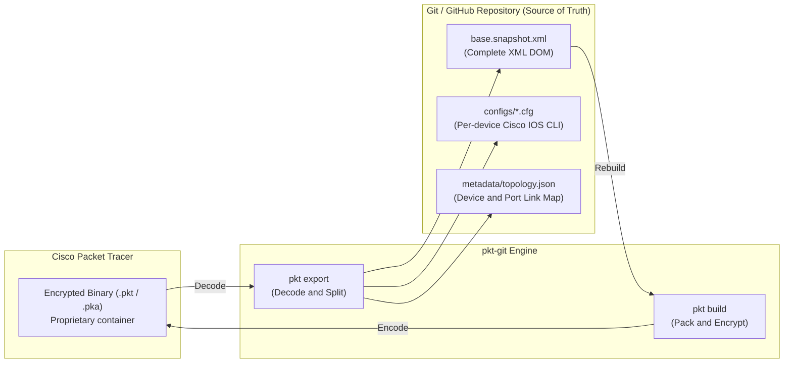
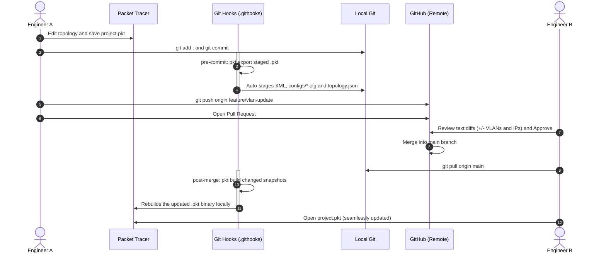
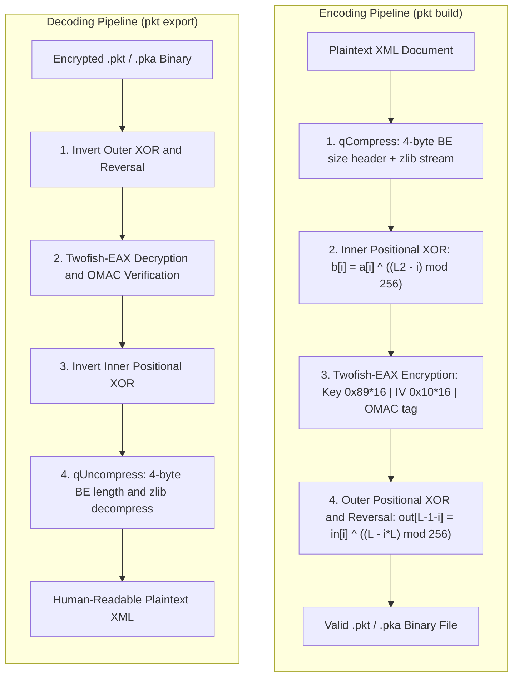

<p align="center">
  
</p>

<p align="center">
  <strong>Git-style version control and human-readable text diffs for Cisco Packet Tracer projects.</strong>
</p>

<p align="center">
  <a href="https://go.dev/dl/"></a>
  <a href="#compatibility"></a>
  <a href="#license--disclaimer"></a>
  <a href="#quickstart--installation"></a>
  <a href="#the-collaborative-workflow"></a>
</p>

---

## Table of Contents

- [Overview](#overview)
- [The Problem vs. The Solution](#the-problem-vs-the-solution)
- [Key Features](#key-features)
- [How It Works](#how-it-works)
- [Everyday Use Cases & Recipes](#everyday-use-cases--recipes)
- [Quickstart & Installation](#quickstart--installation)
- [The Collaborative Workflow](#the-collaborative-workflow)
- [CLI Reference](#cli-reference)
- [Documentation Index](#documentation-index)
- [Reverse Engineering & Binary Format](#reverse-engineering--binary-format)
- [Compatibility](#compatibility)
- [Contributing](#contributing)
- [License & Disclaimer](#license--disclaimer)

---

## Overview

**pkt-git** bridges network engineering and modern software collaboration. It
unpacks the proprietary, reversibly encrypted Cisco Packet Tracer binaries
(`.pkt` / `.pka`) into structured XML, individual Cisco IOS device
configurations (`.cfg`), and topology metadata.

With **pkt-git**, network topologies become Git-native: inspect line-by-line
diffs, review Pull Requests on GitHub, branch freely without losing work, and
rebuild valid Packet Tracer files automatically. The tool is a single Go
binary; nothing is installed inside Packet Tracer.

---

## The Problem vs. The Solution

| The Old Way (Binary Chaos) | The pkt-git Way (Git-Native Networks) |
|---|---|
| **Opaque Binaries:** `.pkt` files cannot be diffed or merged natively by Git. | **Textual Source of Truth:** Text snapshots (`base.snapshot.xml` + per-device `.cfg`) represent repository state. |
| **Lost Changes:** Teammates overwrite each other's configurations when saving simultaneously. | **Branching & PRs:** Review network changes (IPs, VLANs, routing tables) via standard GitHub Pull Requests. |
| **Messy File Naming:** Folders cluttered with `lab_final_v2_fixed(3).pkt`. | **Clean Commit History:** Every network iteration is tracked by standard Git commit hashes and tags. |
| **Manual Audits:** Checking what changed requires opening Packet Tracer and inspecting every device. | **Instant Diffs:** Run `git diff` to immediately see modified interfaces, ACLs, or device hostnames. |

---

## Key Features

- ⚡ **Zero-Footprint in Packet Tracer:** Works externally on files, even when PT is closed.
- 🔄 **Fully Bidirectional & Reversible:** Export `.pkt` to structured XML/configs, and rebuild the binary anytime with `pkt build`.
- 🪝 **Transparent Git Hooks:** `pre-commit` exports snapshots on commit; `post-merge` and `post-checkout` rebuild binaries on pull or branch change.
- 🛡️ **Safe CLI Editing:** `pkt edit` updates one device's interface or config lines with byte-offset edits and full XML validation.
- 🌐 **Internationalization (i18n):** Full multilingual CLI support in English and Spanish with persistent Git configuration (`pkt.language`) and interactive selection (`pkt language`).
- 🩺 **Environment Doctor:** Diagnostic command (`pkt doctor`) checking Git identity, PATH configuration, agent skills, and performing deep cross-platform searches for Cisco Packet Tracer installations.
- 🎨 **Modern CLI UX:** Grouped help navigation, progressive animated welcome banner (`pkt welcome`), Unicode tabular topology inspection with role badges, humanized file sizes, and full `NO_COLOR` / TTY compliance.
- 🤖 **Agent Skills:** Bundled skill for OpenCode, Claude Code, and Gemini CLI, installable with `pkt skills`.
- 💻 **Cross-Platform:** Linux, macOS, and Windows; no cgo or C runtime.

---

## How It Works



The binary file is a **regenerable artifact**; the human-readable text snapshot
is the true versioned source of truth.

---

## Everyday Use Cases & Recipes

A 30-second cheat sheet for the most common network engineering flows:

| Scenario | What to run |
|---|---|
| 🚀 **1. Starting a New Repo** | `git init` ➔ `pkt init` ➔ save in Packet Tracer (`Ctrl+S`) ➔ `git commit` |
| 👥 **2. Joining a Teammate's Repo** | `git clone <url>` ➔ `cd <repo>` ➔ **`pkt init`** *(one-time hook setup)* |
| 💾 **3. Daily Working & Saving** | Edit in Packet Tracer ➔ `Ctrl+S` ➔ `git add .` ➔ `git commit -m "..."` |
| 📥 **4. Pulling Updates from Team** | `git pull` *(hooks rebuild your local `.pkt` binary automatically)* |
| ⚔️ **5. Resolving Merge Conflicts** | `pkt resolve --theirs` (or `--ours`, or manual edit) |
| 🌐 **6. Switching Language** | `pkt lang es` (Spanish) or `pkt lang en` (English) |
| 🩺 **7. System Health Check** | `pkt doctor` *(inspects Git identity, Packet Tracer installation, and PATH)* |
| 📦 **8. Batch Multi-Project Export** | `pkt export --all` *(exports all topologies in workspace)* |

<details open>
<summary><strong>Case 1: Starting a New Repository or Importing a .pkt</strong></summary>

When putting a local Packet Tracer project under Git version control:

```bash
cd my-project && git init -b main
# Place your topology file inside (e.g., topologia/network.pkt)
pkt init                                            # auto-detects .pkt, wires hooks, exports snapshot
git add . && git commit -m "chore: import PT project"
git remote add origin git@github.com:<you>/my-project.git
git push -u origin main
```
`pkt init` discovers any `.pkt`/`.pka` files and creates the initial `snapshot/<project>/` automatically.
</details>

<details open>
<summary><strong>Case 2: Joining an Existing Project (Teammate Onboarding)</strong></summary>

When cloning a repository already using pkt-git:

```bash
git clone git@github.com:<org>/my-project.git
cd my-project
pkt init                                            # MANDATORY: wires local hooks and sets binary path
```

> [!IMPORTANT]
> **Why `pkt init` is required after cloning:**  
> For security reasons, Git **never** activates hooks automatically upon `git clone`. Running `pkt init` once links `.githooks/` locally and registers your machine's `pkt` executable path, ensuring incoming pulls rebuild `.pkt` binaries and commits auto-export snapshots.
</details>

<details open>
<summary><strong>Case 3: The Daily 3-Command Loop</strong></summary>

The everyday workflow while editing in Cisco Packet Tracer:

```bash
# 1. In Packet Tracer: edit interfaces, routers, VLANs -> Ctrl+S
# 2. In your terminal:
git add .
git commit -m "feat: configure OSPF and vlan 20 on core router"
git push
```
The `pre-commit` hook automatically detects the modified `.pkt`, extracts the updated XML, device `.cfg` files, and `topology.json`, and stages them alongside the commit.
</details>

<details open>
<summary><strong>Case 4: Receiving Remote Updates</strong></summary>

When your teammates push changes to the repository:

```bash
git pull
```
The `post-merge` hook runs automatically, detects snapshot text changes, and rebuilds the local `.pkt` binary. When you open Packet Tracer, all team changes are already in place.
</details>

<details>
<summary><strong>Case 5: Resolving Merge Conflicts</strong></summary>

When two branches modify the same device configuration line:

```bash
git merge feature/branch                # Git reports conflict in snapshot text
pkt resolve                             # reports exact conflicting files and lines
pkt resolve --theirs                    # accept incoming branch version
# or: pkt resolve --ours                # keep current branch version
git commit -m "merge: resolve conflict" # hook re-exports and finishes
```
`pkt resolve` updates the XML, regenerates `.cfg` files, rebuilds the binary, and stages the resolved files.
</details>

<details>
<summary><strong>Case 6: Changing CLI Language</strong></summary>

```bash
pkt language          # Interactive menu in your terminal (TTY)
pkt lang es           # Set language to Spanish globally (~/.gitconfig)
pkt lang en           # Set language to English globally (~/.gitconfig)
pkt lang es --local   # Set language to Spanish only for current repository
```
</details>

---

## Quickstart & Installation

### Prerequisites

- **Go 1.27+** to build from source (prebuilt release binaries need no Go).
- **Git 2.x**.
- **Cisco Packet Tracer 9.0.1+** only to edit and run topologies; not required
  to review diffs or run CI.

### Install the binary

Linux / macOS, from a clone:

```bash
git clone https://github.com/MarkOne-dev/pkt-git.git
cd pkt-git
./scripts/install.sh
pkt --version
```

Windows (PowerShell), from a clone:

```powershell
git clone https://github.com/MarkOne-dev/pkt-git.git
cd pkt-git
powershell -ExecutionPolicy Bypass -File scripts/install.ps1
pkt.exe --version
```

The scripts automatically install Git if missing, configure your Git identity,
configure `PATH` in your shell, install the binary into `~/.local/bin`, install the
agent skills, and run `pkt doctor` to verify your environment. See
[Installation & Setup](docs/installation.md) for `PKTG_BIN_DIR`, `PKTG_SOURCE`, and
manual build options.

Manual build:

```bash
make build
install -m 0755 bin/pkt ~/.local/bin/pkt
```

On Windows, use `CGO_ENABLED=0 go build -o pkt.exe ./cmd/pkt`. `make dist`
produces self-contained release artifacts for Linux, macOS, and Windows; place
the artifact for your platform on `PATH`.

### Wiring a repository (once per project)

```bash
cd /path/to/your-pt-project
pkt init
```

`pkt init` writes the thin hooks into `.githooks/`, records the absolute binary
path in repository-local `pktgit.bin`, activates `core.hooksPath`, and merges
the required `.gitattributes` rules. It is idempotent and refuses to modify a
directory that is not a Git repository.

### Agent skills (OpenCode / Claude Code / Gemini CLI)

The binary embeds the pkt-git skill. Install it into the three global skill
directories with:

```bash
pkt skills              # ~/.config/opencode, ~/.claude, ~/.gemini
pkt skills --remove     # remove only the pkt-git skill
```

| Skill installed at agent | Agent picks it up |
|---|---|
| `~/.config/opencode/skills/pkt-git/` | OpenCode (global scope) |
| `~/.claude/skills/pkt-git/` | Claude Code |
| `~/.gemini/skills/pkt-git/` | Gemini CLI |

---

## The Collaborative Workflow

With hooks enabled by `pkt init`, the day-to-day workflow requires zero manual
exports:



A text-only snapshot change (for example, a resolved merge) is allowed by
`pre-commit` but produces a warning: rebuild the binary with `pkt build` before
opening it in Packet Tracer. Squash merges are handled from the staged index
because `HEAD` does not move; branch checkouts rebuild only changed projects.

### Real-World Git Diff Example

When you change an interface configuration or VLAN in Packet Tracer and commit,
GitHub shows clean text diffs:

```diff
--- a/snapshot/topologia/configs/SW_ACC_ADMIN_PUNO.cfg
+++ b/snapshot/topologia/configs/SW_ACC_ADMIN_PUNO.cfg
@@ -15,7 +15,7 @@ interface FastEthernet0/2
 !
 interface FastEthernet0/3
  description Connection to Dept Admin
- switchport access vlan 50
+ switchport access vlan 60
  switchport mode access
  spanning-tree portfast
 !
```

---

## CLI Reference

`pkt` is a single Go binary. The full reference is in
[`docs/cli-reference.md`](docs/cli-reference.md).

```bash
pkt init [dir]                                  # wire hooks + .gitattributes
pkt export <project.pkt> <output_dir>           # binary -> textual snapshot
pkt build  <snapshot.xml> <output.pkt>          # snapshot -> valid binary
pkt inspect <project.pkt>                       # devices/links summary
pkt edit  <xml> show <DEVICE>                   # redacted running config
pkt edit  <xml> chgline <DEV> <IFACE> <old> <new>
pkt edit  <xml> setiface <DEV> <IFACE> "line"...
pkt edit  <xml> insertafter <DEV> <phrase> "line"...
pkt sync  <snapshot-dir|snapshot.xml>           # refresh configs + metadata
pkt resolve [--ours|--theirs]                   # report or resolve conflicts
pkt verify <file.pkt>                           # crypto round-trip verification
pkt skills [--remove]                           # manage the bundled agent skill
pkt doctor                                      # verify environment & prerequisites
pkt language [code] [--local]                   # view/set language (alias: pkt lang)
pkt welcome                                     # show animated welcome banner
pkt version                                     # version and build metadata
```

`pkt --help` lists the public commands and omits the hidden hook entry points
(`pre-commit`, `post-merge`, `post-checkout`). Exit codes are `0` for success,
`1` for runtime failures, and `2` for usage errors.

---

## Documentation Index

Detailed guides and specifications in [`docs/`](docs/README.md):

| Document | Covers |
|---|---|
| [Architecture Overview](docs/architecture.md) | Components, artifact-vs-source-of-truth model, full data flow. |
| [The .pkt Binary Format](docs/packet-tracer-format.md) | The 4-layer crypto pipeline and EAX internals with exact constants. |
| [Snapshot Format](docs/snapshot-format.md) | `base.snapshot.xml`, per-device `.cfg`, `topology.json` and Git rules. |
| [Use Cases & Tested Flows](docs/use-cases.md) | Twelve concrete, project-validated flows: bootstrap → onboarding → gitflow → localization → conflicts. |
| [Collaborative Workflow](docs/workflow.md) | Daily loop, hook automation, PRs, conflict resolution SOP. |
| [CLI Reference](docs/cli-reference.md) | Every `pkt` command, argument, flag, and output. |
| [Installation & Setup](docs/installation.md) | Binary install, `pkt init`, migration, platform matrix. |
| [Troubleshooting & Pitfalls](docs/troubleshooting.md) | Failure modes, dangerous patterns, compatibility limits. |

---

## Reverse Engineering & Binary Format

The `.pkt` and `.pka` files created by Cisco Packet Tracer (validated against
version `9.0.1.0858`) use a reversible 4-layer cryptographic pipeline:



- **Decoding:** Inverts the encoding process strictly: `4 -> 3 -> 2 -> 1`.
- **Implementation:** Go standard-library zlib, `golang.org/x/crypto/twofish`,
  and in-house CMAC/EAX under `internal/crypto`. No cgo or Python runtime is
  involved. Authentication-tag and declared-length mismatches are hard
  failures.

---

## Compatibility

| Component | Tested Version | Status |
|---|---|---|
| **Cisco Packet Tracer** | `9.0.1.0858` | Fully supported and verified |
| **Go** | `1.27+` | Build requirement; prebuilt binaries need no Go |
| **Git** | `2.30+` | Supported |
| **Linux** | Reference environment | Fully tested |
| **macOS / Windows** | Supported by design | Build or use a release archive |

---

## Contributing

Contributions from network engineers, developers, and students are welcome!

1. **Fork the repository** on GitHub.
2. **Create a feature branch:**
   ```bash
   git checkout -b feature/awesome-feature
   ```
3. **Build and validate changes:**
   ```bash
   make test
   make build
   pkt verify testdata/specimens/Caso1_Grupo09-2.pkt
   ```
4. **Commit your changes and push:**
   ```bash
   git commit -m "feat: add support for new packet tracer feature"
   git push origin feature/awesome-feature
   ```
5. **Open a Pull Request** describing your additions and specimen files tested.

---

## License & Disclaimer

This project is licensed under the **[MIT License](LICENSE)**.

### Disclaimer
*Cisco, Cisco Systems, and Cisco Packet Tracer are registered trademarks of Cisco Systems, Inc. and/or its affiliates. This open-source project is an independent community development and is not affiliated with, sponsored by, or endorsed by Cisco Systems, Inc.*
