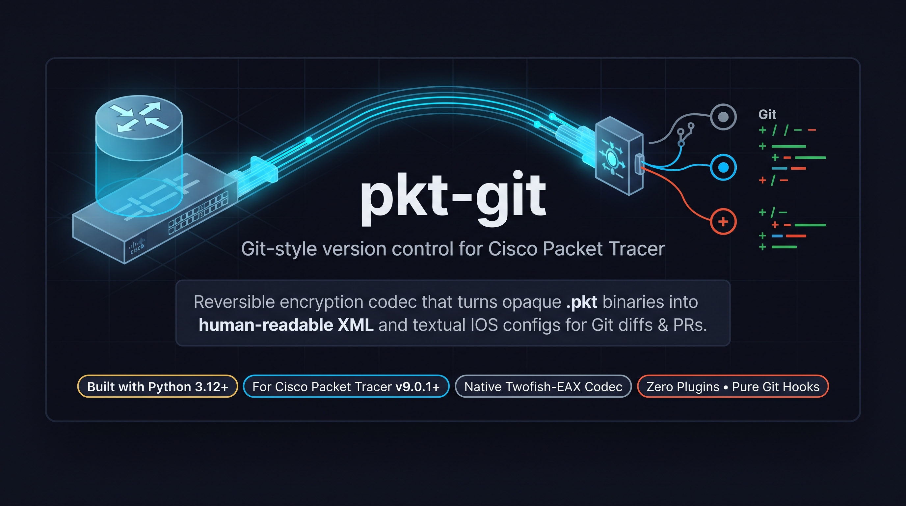
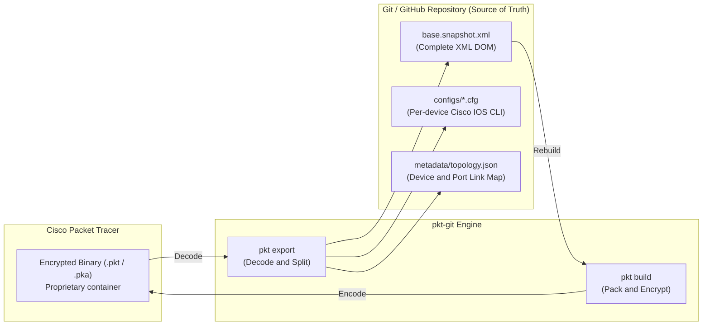
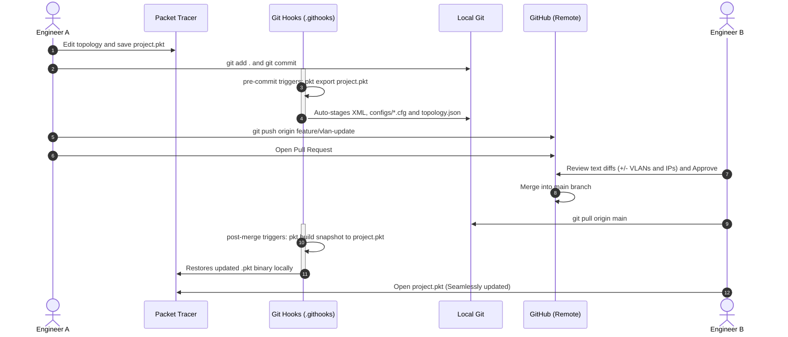
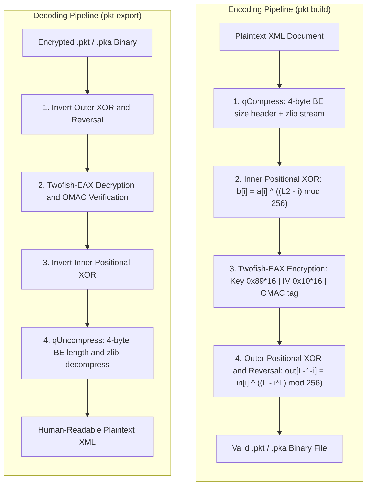

<p align="center">
  
</p>

<p align="center">
  <strong>Git-style version control and human-readable text diffs for Cisco Packet Tracer projects.</strong>
</p>

<p align="center">
  <a href="https://www.python.org/downloads/"></a>
  <a href="#compatibility"></a>
  <a href="#license--disclaimer"></a>
  <a href="#quickstart--installation"></a>
  <a href="#the-collaborative-workflow"></a>
</p>

---

## Table of Contents

- [Overview](#overview)
- [The Problem vs. The Solution](#the-problem-vs-the-solution)
- [Key Features](#key-features)
- [How It Works](#how-it-works)
- [Documentation](#documentation)
- [Quickstart & Installation](#quickstart--installation)
  - [Linux (Debian / Ubuntu / Arch / Fedora)](#linux-debian--ubuntu--arch--fedora)
  - [macOS](#macos)
  - [Windows (PowerShell)](#windows-powershell)
  - [Tarball Bootstrap (No Git)](#tarball-bootstrap-curl-only)
- [The Collaborative Workflow](#the-collaborative-workflow)
- [CLI Reference](#cli-reference)
  - [`ptg.py` — Core Converter](#toolsptgpy)
  - [`edit_config.py` — Safe CLI Editor](#toolsedit_configpy)
  - [`spike_roundtrip.py` — Cryptographic Verifier](#toolsspike_roundtrippy)
- [Reverse Engineering & Binary Format](#reverse-engineering--binary-format)
- [Compatibility](#compatibility)
- [Contributing](#contributing)
- [License & Disclaimer](#license--disclaimer)

---

## Overview

**pkt-git** bridges the gap between network engineering and modern software collaboration practices. It unpacks proprietary, reversibly-encrypted Cisco Packet Tracer binaries (`.pkt` / `.pka`) into structured XML, individual Cisco IOS device configurations (`.cfg`), and topology metadata.

With **pkt-git**, network topologies become Git-native: inspect line-by-line diffs, review Pull Requests on GitHub, branch freely without losing work, and rebuild valid Packet Tracer files automatically.

---

## The Problem vs. The Solution

| The Old Way (Binary Chaos) | The pkt-git Way (Git-Native Networks) |
|---|---|
| **Opaque Binaries:** `.pkt` files cannot be diffed or merged natively by Git. | **Textual Source of Truth:** Text snapshots (`base.snapshot.xml` + per-device `.cfg`) represent repository state. |
| **Lost Changes:** Teammates overwrite each other's configurations when saving simultaneously. | **Branching & PRs:** Review network changes (IPs, VLANs, routing tables) via standard GitHub Pull Requests. |
| **Messy File Naming:** Folders cluttered with `lab_final_v2_fixed(3).pkt`. | **Clean Commit History:** Every network iteration is tracked by standard Git commit hashes and tags. |
| **Manual Audits:** Checking what changed requires opening Packet Tracer and inspecting every device. | **Instant Diffs:** Run `git diff` to immediately see modified interfaces, ACLs, or device hostnames. |

---

## Key Features

- ⚡ **Zero-Footprint in Packet Tracer:** Nothing to install inside Packet Tracer. Works externally on files, even when PT is closed.
- 🔄 **Fully Bidirectional & Reversible:** Export `.pkt` to structured XML/configs, and rebuild the exact binary anytime with `pkt build`.
- 🪝 **Transparent Git Hooks:** Automatic `pre-commit` hook extracts snapshots on commit; automatic `post-merge` and `post-checkout` hooks rebuild `.pkt` binaries on branch change or pull.
- 🛡️ **Safe CLI Editing:** Built-in `edit_config.py` allows updating interfaces and commands directly from the terminal without breaking the XML schema.
- 💻 **Cross-Platform:** Tested and supported natively on **Linux**, **macOS**, and **Windows**.

---

## How It Works



The binary file is treated as a **regenerable artifact**, while the human-readable text snapshot acts as the true versioned source of truth.

---

## Documentation

Detailed documentation lives in [`docs/`](docs/README.md):

| Document | Covers |
|---|---|
| [Architecture Overview](docs/architecture.md) | Components, artifact-vs-source-of-truth model, full data flow. |
| [The .pkt Binary Format](docs/packet-tracer-format.md) | The 4-layer crypto pipeline and EAX internals with exact constants. |
| [Snapshot Format](docs/snapshot-format.md) | `base.snapshot.xml`, per-device `.cfg`, `topology.json` and Git rules. |
| [Collaborative Workflow](docs/workflow.md) | Daily loop, hook automation, PRs, conflict resolution SOP. |
| [CLI Reference](docs/cli-reference.md) | Every command of `ptg.py`, `edit_config.py`, `spike_roundtrip.py`. |
| [Installation & Setup](docs/installation.md) | What the installers do step by step, platform matrix. |
| [Troubleshooting & Pitfalls](docs/troubleshooting.md) | Failure modes, dangerous patterns, compatibility limits. |

---

## Quickstart & Installation

### Prerequisites
- **Python 3.12+**
- **Git** and **curl**
- *Cisco Packet Tracer 9.0.1+* (only needed to edit and run topologies; not required to review diffs or run CI).

### Global install (recommended)

Install **once per machine**, then wire any repository with one command — no
templates, nothing to copy between projects:

```bash
# 1) install globally
git clone https://github.com/MarkOne-dev/pkt-git.git && cd pkt-git
./install.sh
# Windows: powershell -ExecutionPolicy Bypass -File install.ps1

# 2) in ANY repository (new or existing PT project):
cd /path/to/your-pt-project
pkt init
```

`pkt init` activates the hooks for that repository automatically.

### Import an existing Packet Tracer project

```bash
pkt export my_project.pkt snapshot/my_project/
mkdir -p topologia && cp my_project.pkt topologia/
git add . && git commit -m "chore: import existing PT project"
```

### Prerequisites per OS

```bash
# Debian / Ubuntu
sudo apt update && sudo apt install -y python3 python3-venv git curl

# Arch Linux
sudo pacman -S --needed python git curl

# Fedora
sudo dnf install -y python3 git curl

# macOS (Homebrew)
brew install python git
curl -fsSL https://github.com/MarkOne-dev/pkt-git/archive/refs/heads/main.tar.gz | tar xz
```

```powershell
# Prerequisites (via winget)
winget install -e --id Python.Python.3.13
winget install -e --id Git.Git
```

> **Note for Windows users:** Git hooks run under Git Bash, which is included automatically with Git for Windows.

---

## The Collaborative Workflow

With hooks enabled by `setup.sh` / `setup.ps1`, the team's day-to-day workflow requires zero manual exports:



### Real-World Git Diff Example

When you change an interface configuration or VLAN in Packet Tracer and commit, GitHub shows clean text diffs:

```diff
--- a/snapshot/topologia/configs/SW_ACC_ADMIN_PUNO.cfg
+++ b/snapshot/topologia/configs/SW_ACC_ADMIN_PUNO.cfg
@@ -15,7 +15,7 @@ interface FastEthernet0/2
 !
 interface FastEthernet0/3
  description Connection to Dept Admin
- switchport access vlan 50
+ switchport access vlan 60
  switchport mode access
  spanning-tree portfast
 !
```

---

## CLI Reference

All scripts run inside the project virtual environment (`.venv`).

### `pkt` — global CLI
One command surface for everything (after the global install):

```bash
# Export a .pkt into base.snapshot.xml, configs/*.cfg, and topology.json
pkt export "project.pkt" snapshot/project/

# Rebuild a working .pkt from a modified XML snapshot
pkt build snapshot/project/base.snapshot.xml topologia/project.pkt

# Inspect devices, interfaces, and connections directly in your terminal
pkt inspect "project.pkt"

# Safe per-device editing of a snapshot (XML validated on every write)
pkt edit snapshot/project/base.snapshot.xml chgline SW1_LIMA FastEthernet0/1 "vlan 10" "vlan 20"

# Keep derived configs/metadata in sync after manual text edits
pkt sync snapshot/project/

# Verify the crypto round trip against any specimen
pkt verify "project.pkt"
```

---

## Reverse Engineering & Binary Format

The `.pkt` and `.pka` files created by Cisco Packet Tracer (validated against version `9.0.1.0858`) are structured with a reversible 4-layer cryptographic pipeline:



- **Decoding:** Inverts the encoding process strictly: $4 \rightarrow 3 \rightarrow 2 \rightarrow 1$.
- **Twofish Implementation:** The core cryptographic operations use pure Python with standard C-level bindings (`twofish` + `pycryptodome`), patched automatically by `setup.sh` / `setup.ps1` for Python 3.12+ compatibility.

---

## Compatibility

| Component | Tested Version | Status |
|---|---|---|
| **Cisco Packet Tracer** | `9.0.1.0858` | Fully supported and verified |
| **Python** | `3.12+` / `3.13` | Supported (Linux, macOS, Windows) |
| **Git** | `2.30+` | Supported |

---

## Contributing

Contributions from network engineers, developers, and students are welcome!

1. **Fork the repository** on GitHub.
2. **Create a feature branch:**
   ```bash
   git checkout -b feature/awesome-feature
   ```
3. **Validate changes:**
   ```bash
   pkt verify "your_specimen.pkt"
   ```
4. **Commit your changes and push:**
   ```bash
   git commit -m "feat: add support for new packet tracer feature"
   git push origin feature/awesome-feature
   ```
5. **Open a Pull Request** describing your additions and specimen files tested.

---

## License & Disclaimer

This project is licensed under the **[MIT License](LICENSE)**.

### Disclaimer
*Cisco, Cisco Systems, and Cisco Packet Tracer are registered trademarks of Cisco Systems, Inc. and/or its affiliates. This open-source project is an independent community development and is not affiliated with, sponsored by, or endorsed by Cisco Systems, Inc.*
