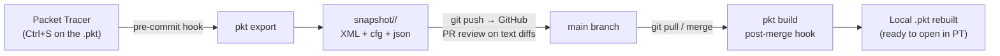

# Architecture Overview

## What pkt-git Is

pkt-git is an in-house version-control bridge for Cisco Packet Tracer projects.
It decrypts proprietary `.pkt` binaries from **outside Packet Tracer** (nothing
is installed inside PT), converts them into a Git-friendly textual snapshot, and
keeps both representations synchronized automatically through Git hooks.

The result: network engineering gets the same collaboration model that software
teams have — commits, `git diff`, branches, Pull Requests on GitHub, and merges
— without ever losing topology work to opaque binary overwrites.

## Core Design Principle

> **The binary is a regenerable artifact; the text is the source of truth.**

| Representation | Role | Versioned? |
|---|---|---|
| `topologia/<Project>.pkt` | The binary artifact that opens in Packet Tracer | Yes (so anyone can open PT immediately), but always regenerable |
| `snapshot/<Project>/base.snapshot.xml` | The complete decrypted XML document | **Yes — authoritative state** |
| `snapshot/<Project>/configs/<Device>.cfg` | Per-device CLI config, extracted for human-readable diffs | **Yes — authoritative for review** |
| `snapshot/<Project>/metadata/topology.json` | Device/link catalog for quick inspection | Yes |

If the `.pkt` binary and the text ever disagree, the rules are:

- Snapshot changed **without** the binary → valid (textual edit/merge); the
  binary is stale and must be rebuilt.
- Binary changed **without** the snapshot → invalid; the pre-commit hook
  refuses to let this happen silently and regenerates the snapshot first.

## Components

```
pkt-git/
├── cmd/pkt/main.go              # Process entry point and exit-code handoff
├── internal/
│   ├── cli/                     # Cobra commands, flags, help, exit codes
│   ├── config/                  # Build metadata and repository config keys
│   ├── codec/                   # .pkt container: decode, encode, verify
│   ├── crypto/
│   │   ├── cmac/                # CMAC/OMAC1 (NIST SP 800-38B)
│   │   ├── eax/                 # EAX mode and tag verification
│   │   └── twofish/             # x/crypto Twofish boundary
│   ├── topology/                # XML -> devices, links, config lines, JSON
│   ├── snapshot/                # export, build, sync, inspect orchestration
│   ├── xmledit/                 # Byte-offset XML index and span edits
│   ├── editor/                  # show/setiface/chgline/insertafter policies
│   ├── security/                # Credential redaction policy
│   ├── gitx/                    # Git command wrapper and path handling
│   ├── hooks/                   # pre-commit, post-merge, post-checkout logic
│   ├── skills/                  # Embedded agent skill asset and installer
│   └── fsx/                     # Atomic writes and safe file helpers
├── testdata/specimens/          # Real .pkt regression inputs
├── scripts/                     # install.sh, install.ps1
├── docs/                        # User and architecture documentation
├── openspec/                    # Specs and change history
├── Makefile
├── go.mod
└── go.sum
```

### Layering

1. **Crypto and codec layer** (`internal/codec`, `internal/crypto/*`) — knows
   nothing about networks. Pure byte pipeline: `.pkt` bytes ↔ UTF-8 XML. CMAC
   and EAX are implemented in-house; Twofish comes from
   `golang.org/x/crypto/twofish` behind a small internal wrapper. Decode treats
   authentication and declared-length mismatches as hard failures.
2. **Topology layer** (`internal/topology`) — parses the XML document into
   ordered `Device`, `Link`, and `Endpoint` values, produces per-device config
   bytes and the deterministic JSON catalog. Knows nothing about crypto or the
   filesystem.
3. **Snapshot layer** (`internal/snapshot`) — owns the filesystem contract:
   `Export` decodes and parses before writing, `Build` validates and encodes
   atomically, `Sync` regenerates derived files and prunes stale configs, and
   `Inspect` is read-only.
4. **Editing layer** (`internal/xmledit`, `internal/editor`,
   `internal/security`) — device-scoped byte-span edits on the snapshot with
   whole-document validation before write. Never touches the binary.
5. **Automation layer** (`internal/gitx`, `internal/hooks`) — glues the layers
   to Git events so the common user never invokes the CLI manually.
6. **CLI layer** (`internal/cli`) — Cobra command tree, argument validation, and
   explicit exit codes. It depends on the feature packages; they do not depend
   on it.

## Data Flow



### Direction 1 — Save (PT → repository)

1. Engineer edits the topology in Packet Tracer and saves.
2. `git add` + `git commit`: the **pre-commit** hook detects a staged `.pkt`.
3. The hook runs `pkt export`, which decrypts the binary and writes the textual
   snapshot, then stages the snapshot automatically.
4. Every commit, seen by Git and by GitHub, is a *pair*: binary + text, always
   in sync.

### Direction 2 — Receive (repository → PT)

1. Engineer runs `git pull` (or merges a branch, or checks out a branch).
2. The **post-merge** / **post-checkout** hook diffs the incoming commits for
   `snapshot/*/base.snapshot.xml` changes.
3. For every changed snapshot it runs `pkt build`, regenerating
   `topologia/<Project>.pkt` atomically.
4. The engineer opens Packet Tracer and the network is already there — zero
   manual conversion steps in the daily loop.

### Exception — Text-first edits

A maintainer resolving a textual merge conflict edits only the snapshot. The
binary becomes stale; `pkt build` must be run once (the pre-commit hook prints
an explicit reminder whenever this state is detected). This is the only
situation in the daily life of the team where a manual conversion command exists.

## Why Hooks Instead of Wrapper Commands

The project deliberately chose **versioned hooks inside the repository**
(`.githooks/`, activated with `git config core.hooksPath .githooks` by
`pkt init`) over installing global tooling:

- The automation travels with the repository — cloning it plus running
  `pkt init` gives any teammate the full pipeline.
- No global state is touched: other unrelated Git repositories on the same
  machine behave 100% conventionally (hooks only act on `.pkt`/snapshot paths).
- Naming and shelving stay standard Git; pkt-git adds no new VCS vocabulary.

`pkt init` writes thin POSIX shell hooks that execute the running binary
recorded in the repository-local `pktgit.bin` key. The old `pktgit.py`,
`pktgit.script`, and `setup.sh`/`setup.ps1` flow is retired.

## Pure-Go Dependency Policy

The shipped tool has no Python, virtualenv, cgo, or C toolchain dependency:

- CMAC/OMAC1 (NIST SP 800-38B) and EAX mode are implemented from the standard
  in `internal/crypto`.
- Twofish is the maintained pure-Go implementation from
  `golang.org/x/crypto/twofish`.
- XML parsing uses the Go standard library (`encoding/xml`), including
  `InputOffset()` for byte-preserving edits.
- Compression uses the Go standard library (`compress/zlib`, level 9) with the
  Qt `qCompress` size header.
- Filesystem writes go through `internal/fsx`: same-directory temporary file,
  sync, close, and rename over the destination.
