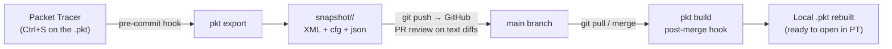

# Architecture Overview

## What pkt-git Is

pkt-git is an in-house version-control bridge for Cisco Packet Tracer projects.
It decrypts proprietary `.pkt` binaries from **outside Packet Tracer** (nothing
is installed inside PT), converts them into a Git-friendly textual snapshot, and
keeps both representations synchronized automatically through Git hooks.

The result: network engineering gets the same collaboration model that software
teams have — commits, `git diff`, branches, Pull Requests on GitHub, and merges
— without ever losing topology work to opaque binary overwrites.

## Core Design Principle

> **The binary is a regenerable artifact; the text is the source of truth.**

| Representation | Role | Versioned? |
|---|---|---|
| `topologia/<Project>.pkt` | The binary artifact that opens in Packet Tracer | Yes (so anyone can open PT immediately), but always regenerable |
| `snapshot/<Project>/base.snapshot.xml` | The complete decrypted XML document | **Yes — authoritative state** |
| `snapshot/<Project>/configs/<Device>.cfg` | Per-device CLI config, extracted for human-readable diffs | **Yes — authoritative for review** |
| `snapshot/<Project>/metadata/topology.json` | Device/link catalog for quick inspection | Yes |

If the `.pkt` binary and the text ever disagree, the rules are:

- Snapshot changed **without** the binary → valid (textual edit/merge); the
  binary is stale and must be rebuilt.
- Binary changed **without** the snapshot → invalid; the pre-commit hook
  refuses to let this happen silently and regenerates the snapshot first.

## Components

```
pkt-git/
├── tools/
│   ├── spike_roundtrip.py   # Codec: decode/encode .pkt <-> XML + crypto core
│   ├── ptg.py               # CLI: export / build / inspect + topology parser
│   ├── edit_config.py       # Device-scoped surgical XML editor
│   └── cli.py               # Global `pkt` hub: init, thin-hook entries, sync
├── .githooks/               # Development-clone hooks (self-hosted variant)
├── install.sh               # Global one-machine install (Linux/macOS/Git Bash)
├── install.ps1              # Global one-machine install (Windows PowerShell)
├── setup.sh                 # Legacy per-repository installer (repo self-hosted)
├── setup.ps1                # Legacy per-repository installer (Windows)
├── topologia/               # Canonical binary artifacts in the repo
└── snapshot/                # Textual snapshots (the source of truth)
```

### Layering

1. **Crypto layer** (`spike_roundtrip.py`) — knows nothing about networks.
   Pure byte pipeline: file bytes ↔ UTF-8 XML text. Also implements CMAC/OMAC1
   and EAX in-house (the `twofish` block cipher binding is used as a validation
   reference only).
2. **Topology layer** (`ptg.py`) — parses the XML document into dataclasses
   (`Device`, `Link`, `Endpoint`), producing the per-device configs and the JSON
   catalog. Knows nothing about crypto.
3. **Editing layer** (`edit_config.py`) — device-scoped string surgery on the
   snapshot with XML validation before every write. Never touches bin.
4. **Automation layer** (hooks) — glues the layers to Git events so the common
   user never invokes the CLI manually.

## Data Flow



### Direction 1 — Save (PT → repository)

1. Engineer edits the topology in Packet Tracer and saves.
2. `git add` + `git commit`: the **pre-commit** hook detects a staged `.pkt`.
3. The hook runs `pkt export`, which decrypts the binary and writes the textual
   snapshot, then stages the snapshot automatically.
4. Every commit, seen by Git and by GitHub, is a *pair*: binary + text, always
   in sync.

### Direction 2 — Receive (repository → PT)

1. Engineer runs `git pull` (or merges a branch, or checks out a branch).
2. The **post-merge** / **post-checkout** hook diffs the incoming commits for
   `snapshot/*/base.snapshot.xml` changes.
3. For every changed snapshot it runs `pkt build`, regenerating
   `topologia/<Project>.pkt`.
4. The engineer opens Packet Tracer and the network is already there — zero
   manual conversion steps in the daily loop.

### Exception — Text-first edits

A maintainer resolving a textual merge conflict edits only the snapshot. The
binary becomes stale; `pkt build` must be run once (the pre-commit hook prints
an explicit reminder whenever this state is detected). This is the only
situation in the daily life of the team where a manual conversion command exists.

## Why Hooks Instead of Wrapper Commands

The project deliberately chose **versioned hooks inside the repository**
(`.githooks/` activated via `git config core.hooksPath .githooks` by `setup`)
over installing global tooling:

- The automation travels with the repository — cloning it plus running setup
  gives any teammate the full pipeline.
- No global state is touched: other unrelated Git repositories on the same
  machine behave 100% conventionally (hooks only act on `.pkt`/snapshot paths).
- Naming and shelving stay standard Git; pkt-git adds no new VCS vocabulary.

## In-House-Only Policy

No third-party core dependency is used for the actual work:

- CMAC/OMAC1 (NIST SP 800-38B) and EAX mode: implemented from the standard, in
  `spike_roundtrip.py`.
- Twofish block cipher: used through the `twofish` package strictly as a
  validation oracle; shipping a pure-Python implementation is the planned step
  to remove the only C-compiled dependency (relevant on Windows where a compiler
  may be missing — see `installation.md`).
- XML parsing: Python standard library (`xml.etree.ElementTree`).
- Compression: Python standard library (`zlib`, matching Qt's `qCompress`).
